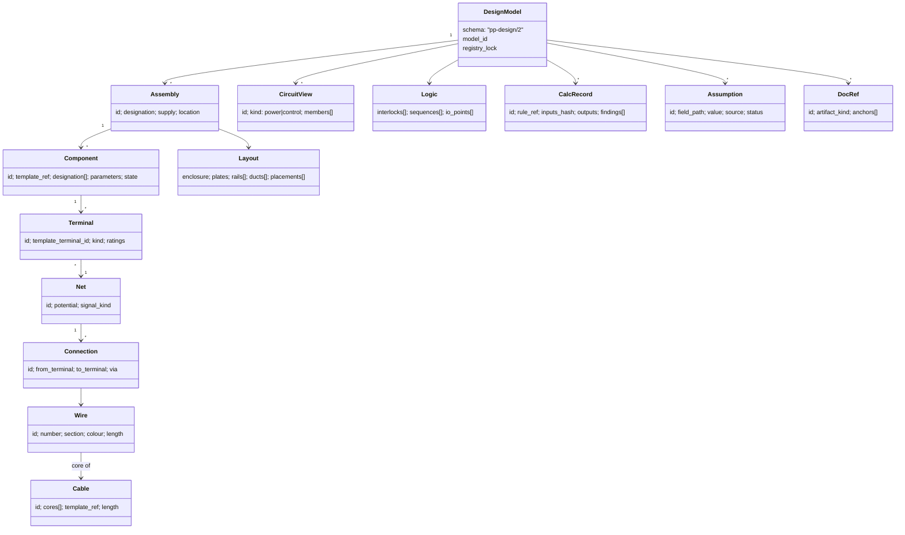
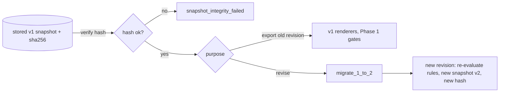
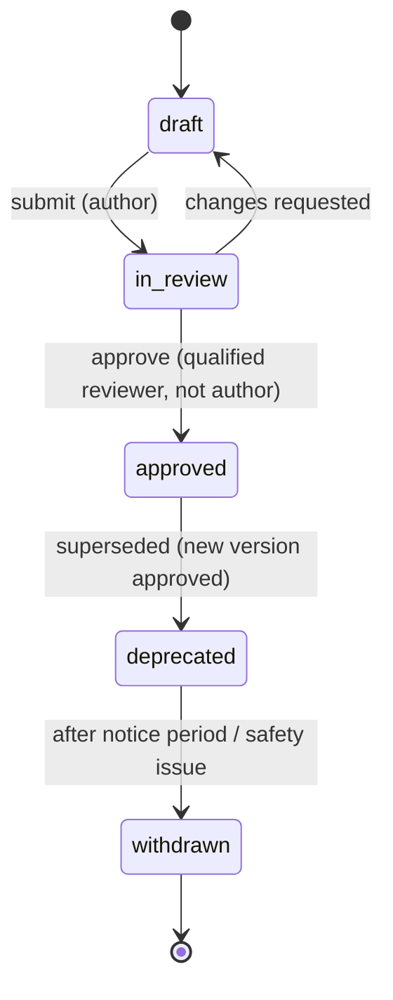
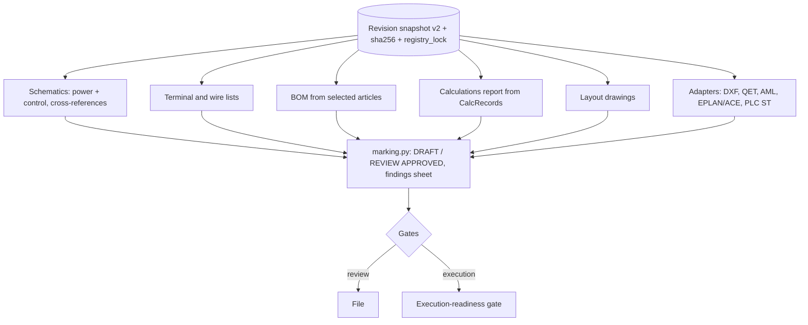
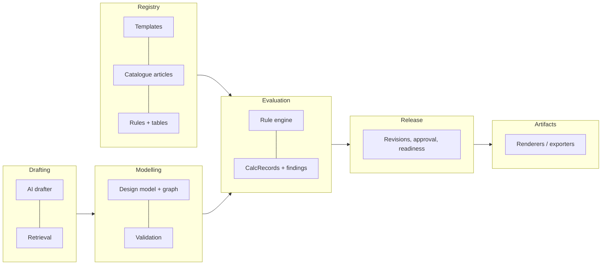

# Dynamic electrical design engine: architecture proposal

**Status:** Proposal for review. Design and research only; nothing here is implemented.
**Baseline:** `feat/phase1-trustworthy-export` at `8f21ab9` (PR #203, Phase 1).
**Date:** 2026-10-27.
**Scope note:** This document claims compliance with no standard. Every standards reference below is "requirements to be verified by a qualified engineer against edition X". Customer reference drawings are treated as anonymous test cases; no customer-identifying detail is reproduced here.

## 0. Executive summary

PanelPilot today is a **sourced calculation core for distribution boards**. It turns a load schedule into a `DesignProject` (boards, devices, cables, circuits, parts), sizes breakers, cables, RCD groups and motor starters from cited tables, classifies every note into blocking or warning or info findings, and, since Phase 1, freezes a server-built snapshot with a SHA-256 hash that approval and export are bound to. Export for execution is refused unconditionally.

The model cannot grow into an execution package as it stands. It has no terminals on devices, no wires or nets, no control circuits, no logic model (the PLC program is generated beside the design, not from it), no dimensioned layout, no catalogue (`CATALOGUE_VERSION = "none"`), and rule provenance is held in docstrings and string constants, not as data. Every family of panel that is not a distribution board would have to be hard-coded into `distribution.py`, `motors.py` or `pages.py`.

This proposal replaces that path with:

1. **One versioned design model** (schema `pp-design/2`): components instantiated from catalogue templates, with typed terminals; a connectivity graph of nets and potentials; wires and cables as graph edges; power and control circuits as views over the graph; a logic model (interlocks, sequences, PLC I/O); a physical layout; calculation records (inputs, rule version, outputs); and document references.
2. **A template and rule registry** with provenance (source, edition, clause), a review and approval workflow, semantic versioning, deprecation, and global versus tenant-private scopes.
3. **A strict AI/deterministic split:** AI drafts a model and lists missing data and assumptions with citations; pure-function rules size, check and decide. AI never sets a rating.
4. **Derived artifacts** (drawings, BOM, calculations, exports) generated from one revision snapshot, with Phase 1's marking, hashing and gates carried over unchanged.
5. **A staged migration** M1 to M8 in which today's pipeline keeps working, and Phase 1's guarantees are pinned by tests at every step.

**Proposed next milestone (M1):** the `pp-design/2` schema envelope plus a lossless, hash-stable adapter from today's `DesignProject`, with schema versioning of snapshots, and no behaviour change. Section 12 gives scope and acceptance criteria.

## Part I: Verified current capabilities

Everything in this part was read in the code at `8f21ab9`. "Missing" means it was searched for and not found.

### 1. The design pipeline

| Area                       | What exists                                                                                                                                                                                                                                      | File                                                                                                                                        |
| -------------------------- | ------------------------------------------------------------------------------------------------------------------------------------------------------------------------------------------------------------------------------------------------ | ------------------------------------------------------------------------------------------------------------------------------------------- |
| Project model              | `DesignProject` → `Board` → `Device`, `Cable`, `Circuit`, `Supply`, `DesignNote`; `Part` list. Strict models (unknown fields refused). Reference resolution validated (`_references_resolve`, `_parts_resolve`).                                 | `apps/api/app/models/schemas/design.py` (lines ~42–525)                                                                                     |
| Device kinds               | A closed `StrEnum` `DeviceKind` of 18 values (breaker, RCD, contactor, overload, drive, relay, PSU, meter, lamp, terminal strip…, `OTHER`). New kinds require a code change.                                                                     | `models/schemas/design.py` `DeviceKind`                                                                                                     |
| Load kinds                 | Closed `LoadKind` enum (lighting, socket, motor, lift, sub-board…).                                                                                                                                                                              | same                                                                                                                                        |
| Topology                   | Tree only: `Device.upstream_id`, `Circuit.upstream_id`, `Circuit.device_ids` (ordered), `Board.fed_from`, `Circuit.feeds`. No nets, no terminals on devices, no wires.                                                                           | same                                                                                                                                        |
| Distribution design        | Ib from P; breaker from company rule or curve C table; cable so Ib ≤ In ≤ Iz; RCD grouping; discrimination ratio; voltage drop; earth-fault loop; let-through energy; fault level.                                                               | `apps/api/app/design/distribution.py`, `voltage_drop.py`, `disconnection.py`, `short_circuit.py`, `fault_level.py`, `mccb.py`, `project.py` |
| Motors                     | DOL, star-delta (Type 2 coordination tables from a manufacturer handbook), drive selection from one manufacturer range. Soft starters and other start methods are missing.                                                                       | `design/motors.py`, `ai/tools/motor_starter.py`, `vfd_selection.py`, `drive_ranges.py`                                                      |
| Terminals                  | Only the board's outgoing strip `-X1`: one terminal per cable core, chosen from one manufacturer range; aluminium left unselected. Device terminals (A1/A2, 1/2, 13/14) are missing.                                                             | `design/terminals.py`, `ai/tools/terminal_blocks.py`                                                                                        |
| Layout                     | DIN-rail rows in single-line order, widths from profile or one sourced module width; unknown widths drawn as dashed slots and excluded from totals. No dimensions, ducts, mounting plate, clearances or heat.                                    | `design/layout.py`, `ai/tools/din_module_width.py`                                                                                          |
| Enclosure                  | Picks one of a small list of modular enclosures from one catalogue, by rows; refuses for MCCBs, starters, drives, high current or fault level.                                                                                                   | `design/enclosure.py`, `ai/tools/enclosure_sizing.py`                                                                                       |
| Designations               | IEC 81346-style `=function+location-product`, assigned from the company profile in drawing order (never typed in).                                                                                                                               | `design/designations.py`, `Designation` in schemas                                                                                          |
| Company profile            | Letters, numbering, title fields, page order, wire numbering mode, preferred manufacturers, circuit rules per load kind, limits (voltage drop, RCD fan-out, discrimination ratio), rail widths. `rules_confirmed_by` empty prints "unconfirmed". | `design/profile.py`, `CompanyProfile`                                                                                                       |
| Markets                    | A handful of markets set supply, earthing, currency and a few numeric code limits, each with its source or "not found".                                                                                                                          | `design/markets.py`                                                                                                                         |
| Notes and findings         | Each `DesignNote` code is classified once in a policy table with a source (cited rule or `"policy"`). Unknown codes become `warning` + `requires_engineering_confirmation`.                                                                      | `design/notes.py`, `design/findings_policy.py`                                                                                              |
| Integrity                  | Re-check on every export: references resolve; In ≤ Iz from the same sourced tables; motor overload is what protects the cable.                                                                                                                   | `design/integrity.py`                                                                                                                       |
| Snapshot                   | Canonical JSON (sorted keys, no whitespace, floats refused) and SHA-256; profile hash.                                                                                                                                                           | `design/snapshot.py`                                                                                                                        |
| Versions                   | `RULES_VERSION = "2026.10.23.1"` (one global constant for all rules); `CATALOGUE_VERSION = "none"`. No schema version field on the snapshot.                                                                                                     | `design/__init__.py`                                                                                                                        |
| Revisions and approval     | Immutable revisions; server-built snapshot; approval locked and bound to the hash; stale detection on rules, profile, catalogue and findings policy; tenant binding (ADR 0003).                                                                  | `domain/design_projects.py`                                                                                                                 |
| Drawings                   | Single-line and distribution pages, notes, cable and parts lists; title block; Arabic/Hebrew text handling; findings sheet.                                                                                                                      | `design/pages.py`, `sheet.py`, `symbols.py`, `drawing_text.py`, `rtl.py`, `render_pdf.py`                                                   |
| Calculations report        | Per circuit figures and methods, with approval or "not approved".                                                                                                                                                                                | `design/calc_report.py`                                                                                                                     |
| Quotation                  | Priced from a company price list by article or rating key; unpriced lines are never guessed.                                                                                                                                                     | `design/quotation.py`, `quotation_pdf.py`                                                                                                   |
| Marking                    | `DRAFT — NOT FOR EXECUTION` or `REVIEW APPROVED — STUDY, NOT FOR EXECUTION` on every format that can carry it.                                                                                                                                   | `design/marking.py`                                                                                                                         |
| Schedule import and markup | CSV/XLSX schedule import, splitting by company rule, reviewer markups turned into proposed edits the engineer applies.                                                                                                                           | `design/schedule_import.py`, `schedule_split.py`, `markups.py`, `markup_suggestions.py`                                                     |

### 2. Exporters

| Exporter               | What it writes                                                                                                                         | Phase 1 status                            | File                                            |
| ---------------------- | -------------------------------------------------------------------------------------------------------------------------------------- | ----------------------------------------- | ----------------------------------------------- |
| PDF, calculations PDF  | Drawing set and report                                                                                                                 | Allowed, marked every page                | `render_pdf.py`, `calc_report.py`               |
| DXF (R12)              | Same sheet geometry; no device or connection data                                                                                      | Allowed, marked                           | `export_dxf.py`                                 |
| Project JSON           | Envelope `{export_status, findings, project}`                                                                                          | Allowed                                   | `domain/design.py`                              |
| QElectroTech `.qet`    | Editable single-line schematic: embedded own symbols with two terminals each (top/bottom), conductors joined by uuid                   | Refused (409 `export_format_unprotected`) | `export_qet.py`                                 |
| AutomationML `.aml`    | CAEX 3.0 hierarchy, devices and cables with attributes, "fed from" internal links; base role class only                                | Refused                                   | `export_aml.py`                                 |
| EPLAN / ACE lists, CSV | Device and terminal list imports to documented column layouts                                                                          | Refused                                   | `export_ecad.py`, `export_lists.py`             |
| PLC (IEC 61131-3 ST)   | One program from the design: switched circuits, DOL, star-delta timers, drive run; fail-safe E-stop; I/O list; parser-based validation | Refused                                   | `design/plc_program.py`, `ai/plc/validation.py` |

The refused set lives in `UNPROTECTED_FORMATS` (`apps/api/app/domain/design.py`), with acceptance criteria for re-enabling in `docs/design-readiness/phase-1-export-integrity.md`.

### 3. AI, tools, guardrails and retrieval

- **Calc tools** are pure functions with citations (`ai/tools/cable_sizing.py` cites a manufacturer handbook that republishes IEC 60364-5-52 tables, with page numbers). **The tool registry is a stub:** `ai/tools/registry.py` `get_registry()` and `to_api_tools()` raise `NotImplementedError`. Tools are called directly from design code, not offered to the model.
- **Cite-or-refuse** (`ai/guardrails/cite_or_refuse.py`): one gate; refusal short-circuits generation; confidence comes from retrieval scores and an absolute relevance floor, never from the model.
- **Citations** (`models/schemas/search.py` `Citation`): `document_id`, `document_title`, `manufacturer`, `page`, `section`. No edition, clause or licence field.
- **Retrieval:** OpenSearch hybrid search with one mapping shared by staging and production indices (`ai/retrieval/mappings.py`, ADR 0001); a verification queue promotes sources.
- **AI drafting:** `ai/schedule_writer.py` turns a description into proposed schedule rows with assumptions; nothing is sized by the model, and the engineer submits the table. `ai/plc/*` generates PLC code checked by a parser, not the model.
- **Catalogue ingestion** (`ingestion/eplan_catalogue.py`) filters an EPLAN Data Portal export for dimensioned panel components. **It is not connected to `app/design/`.**
- **Async:** a worker process exists (`app/worker`) for crawls and maintenance; design runs synchronously in the request.

### 4. Web

`apps/web/src/app/design/page.tsx` and `components/design/*`: load rows, schedule sources, company settings, result view, markups, projects panel, revision status (Saved → Validated → Review approved → Execution blocked, with reasons), quotation and PLC panels. There is no component, terminal, wire, logic or layout editor.

### 5. Engineering gaps (from the readiness assessment, de-identified)

1. Output is a single-line study set, not an execution package: no control schematics, device terminals and cross-references, wire numbers, dimensioned enclosure or orderable parts.
2. No control-logic model: soft starters, hand-off-auto, interlocks, timers, alarms and transfer sequences have nowhere to live.
3. Parts are ratings, not products.
4. No missing-data question loop: lengths, fault level, Ze and starters are never asked.
5. One reference family (fire-pump related) showed control behaviour that may conflict with fire-pump controller requirements, which supports keeping that family out of execution scope (Section 7.6).

## Part II: Proposed architecture

### 6. Standards and data sources

Editions are as found on 2026-10-27 in public catalogue listings; the texts themselves were **not** accessed (they are paywalled). Every row must be confirmed by a qualified engineer on the IEC webstore before it is cited by a rule.

| Reference                | Edition as accessible                                                                                    | Governs                                                                                  | Bearing on the model                                                                                                   |
| ------------------------ | -------------------------------------------------------------------------------------------------------- | ---------------------------------------------------------------------------------------- | ---------------------------------------------------------------------------------------------------------------------- |
| IEC 81346-1              | 2022 (ed. 2, replaces 2009) per catalogue listing                                                        | Structuring principles, reference designations (function `=`, product `-`, location `+`) | Designation aspects on every component; multiple aspects per object. Today only one designation per device.            |
| IEC 81346-2              | Not verified in this research (2019 edition believed current; to be checked)                             | Classification of objects and letter codes                                               | Letter codes become template data, not the `DeviceKind` enum.                                                          |
| IEC 61346                | Superseded by IEC 81346 (stated in general knowledge; withdrawal date not verified here)                 | Former structuring principles                                                            | Do not cite; map any legacy references to 81346.                                                                       |
| IEC 61082-1              | Ed. 3.0, 2014 per a third-party store listing; newer edition not ruled out                               | Preparation of documents (diagrams, cross-references)                                    | Document references, cross-reference rules between sheets, terminal and wire presentation.                             |
| IEC 60617                | Online database (DB); edition model not verified                                                         | Graphical symbols                                                                        | Symbol references on templates; today's symbols are "drawn to IEC 60617 conventions" and must be checked.              |
| IEC 61439-1 / -2         | Not confirmed by this search (2020/2020 editions believed current; to be checked)                        | LV assemblies: design verification, temperature rise, short-circuit withstand            | Assembly-level calculations and verification records; the engine must not claim design verification.                   |
| IEC 60364-5-52           | 2009 + AMD1:2024 (consolidated ed. 3.0, IEC webstore listing); EU harmonised HD 60364-5-52:2011/A12:2023 | Wiring systems, current-carrying capacity, voltage drop                                  | Today's tables are transcribed via a 2006 manufacturer handbook: rule provenance must record that and the edition gap. |
| IEC 60204-1              | Not confirmed by this search (2016 + amendment believed current; to be checked)                          | Electrical equipment of machines: control circuits, E-stop, wire colours                 | Control-circuit rules for machine panels; stop categories in the logic model.                                          |
| IEC 61131-3              | Ed. 4.0 referenced by a VDE preview; date not verified                                                   | PLC languages                                                                            | PLC I/O and program as derived artifacts from the logic model.                                                         |
| IEC 62714 (AutomationML) | Part 1: 2018 (listed current); Part 2 semantics libraries 2022 edition (DIN listing); Part 4 Logic: 2020 | Engineering data exchange                                                                | AML adapter; Part 4 is a candidate for logic exchange.                                                                 |
| IEC 62424                | Not verified in this research (2016 edition believed current)                                            | P&ID / CAEX exchange basis                                                               | CAEX underpinning of AML; low direct impact.                                                                           |
| EPLAN, QElectroTech      | Vendor docs; QET 0.90 example projects used today                                                        | ECAD import formats                                                                      | Exporter adapters only; no internal coupling.                                                                          |
| ECLASS / ETIM            | ECLASS 16.0 (Nov 2025, secondary source; official page still showed 15.0); ETIM 10.0 (Dec 2024)          | Product classification and properties                                                    | Optional classification keys on templates, versioned (ADR-6).                                                          |
| NFPA 20 / EN 12845       | Not researched                                                                                           | Fire-pump installations and controllers                                                  | **Out of execution scope** (Section 7.6).                                                                              |

Sources consulted: [iteh IEC 81346-1:2022](https://iteh.es/catalog/standards/iec/f222381b-a223-4506-a8db-f91c3469657d/iec-81346-1-2022), [VDE IEC 61131-3 ed4 preview](https://www.vde-verlag.de/iec-normen/preview-pdf/info_iec61131-3{ed4.0}b.pdf), [IEC webstore 60364-5-52 AMD1:2024](https://webstore.iec.ch/en/publication/71254), [EVS HD 60364-5-52/A12](https://www.evs.ee/en/evs-hd-60364-5-52-2011-a12-2023), [GlobalSpec IEC 62714-1](https://standards.globalspec.com/std/10378168/iec-62714-1), [DIN EN IEC 62714-2](https://www.dinmedia.de/de/norm/din-en-iec-62714-2/370609736), [ETIM releases](https://etim-international.com/?p=754), [ECLASS (Wikipedia)](https://en.wikipedia.org/wiki/ECLASS), [eclass.eu](https://eclass.eu/en/index.html).

### 7. The shared versioned design model

#### 7.1 Overview



#### 7.2 Entities

- **Component**: an instance of a **template** (`template_ref = {registry, id, version}`), with instance parameters (rated current, setting, poles), one or more designations by aspect (IEC 81346), and an optional selected **article** (catalogue part). A component without a selected article is valid but carries an `unselected_article` finding.
- **Terminal**: typed by the template: `power_line`, `power_neutral`, `protective_earth`, `coil`, `contact_no`, `contact_nc`, `contact_co`, `signal_di`, `signal_do`, `signal_ai`, `signal_ao`, `bus`, `shield`. Carries ratings (max section, current, voltage) and an identifier as marked on the device (e.g. `A1`, `13`). Contacts belong to a **contact group** so a coil and its contacts share an identity (needed for cross-references, IEC 61082-1 to be verified).
- **Net (potential)**: a set of terminals at the same potential, with a signal kind (`L1`, `N`, `PE`, `24VDC+`, `0V`, a control signal). Nets are the connectivity graph; wires are its physical realisation.
- **Connection, Wire, Cable**: a connection joins two terminals in one net; it is realised by a wire (internal) or a cable core (external), or a busbar or jumper. Wire numbers are assigned from the company's wire-numbering rule (today `WireNumbering` exists in the profile but no wires exist).
- **CircuitView**: a power or control circuit is a named, ordered **view** over components and nets, not a separate store. Today's `Circuit` becomes a power circuit view; its `device_ids` order is preserved.
- **Logic**: interlocks (A excludes B; with provenance: electrical, mechanical, software), sequences (state machines with timers and transitions), modes (hand-off-auto), and PLC I/O points bound to terminals. The PLC program is **derived** from Logic, not generated beside the design.
- **Layout**: enclosure (article), mounting plates, rails and ducts with dimensions, placements of components by article dimensions, clearances as rule outputs.
- **CalcRecord**: one per rule evaluation that produced a value: `rule_ref {id, version}`, the canonical hash of its inputs, its outputs, and its findings. This is the trace that makes a figure reproducible.
- **Assumption**: any value not given by the user or derived by a rule (a default power factor, an assumed length), with its source (`profile`, `market`, `ai_draft`, `rule_default`) and status (`open`, `confirmed_by`, `replaced`).
- **DocRef**: anchors from model objects to sheets and positions in derived artifacts, so cross-references and "where to fix" links resolve.

#### 7.3 Identity and determinism

- Every id is stable and assigned once (UUIDv7 or content-free slugs); designations are **derived**, never stored as identity (consistent with `designations.py` today).
- All quantities are `Decimal` dumped as strings; canonical JSON as in `design/snapshot.py`; floats refused. Arrays whose order has no meaning are sorted by id in canonical form; ordered arrays (circuit device order, drawing order) are explicit.

#### 7.4 Schema versioning and snapshot migration (ADR-2)

- *Corrected by M1 (Section 13a):* a later schema is stored in an envelope `{ "schema": "pp-design/N", "model": {...} }` with no other top-level key. `registry_lock` is **deferred** to the milestone that has templates and rules to lock (M2/M3); it will arrive through a schema version and a migration, not as an empty field now. The original proposal: the snapshot gains an envelope `{ "schema": "pp-design/2", "model": {...}, "registry_lock": {...} }`. The `registry_lock` lists every template, rule and catalogue version the model was built with (replacing the single `RULES_VERSION` and `CATALOGUE_VERSION` constants by a precise lock; those constants stay as aggregated digests for the Phase 1 stale check).
- **A saved snapshot and its hash are never rewritten.** Today's rows have no schema field; they are read as `pp-design/1` by definition.
- Migration is a pure, versioned function `migrate_1_to_2(snapshot_v1) -> model_v2`, run **on read** for display and for deriving a new revision. It is never used to export an old revision as if it were the same: an old approved revision exports from its v1 snapshot with v1 renderers (kept until deprecated), or it is `revision_stale` and must be re-saved. This keeps Phase 1's "never recalculates silently" rule.
- Each migration has golden tests: every v1 fixture migrates, re-validates and round-trips; the v1 hash still verifies against the stored bytes.



#### 7.5 Unsupported, uncertain and incomplete

| Situation                               | Handling                                                                                            | Severity                                                      |
| --------------------------------------- | --------------------------------------------------------------------------------------------------- | ------------------------------------------------------------- |
| Device with no template                 | Allowed only as `generic` component with declared terminals; finding `unknown_device_template`      | Warning + requires engineering confirmation; blocks execution |
| Template not approved                   | Usable in drafts only                                                                               | Blocking for approval                                         |
| Rule without source, edition and clause | Cannot be registered as `approved`; only `company_policy` with a named approver                     | n/a (registry refuses)                                        |
| Rule input missing                      | Rule returns `insufficient_input`, never a default it invents; the missing field becomes a question | Blocking if the output is safety-relevant, else warning       |
| Value assumed                           | `Assumption` record; listed on the findings sheet                                                   | Warning + confirmation until confirmed                        |
| Unclassified finding code               | As today: warning + confirmation (`findings_policy.classify`)                                       | Warning                                                       |
| Out-of-scope domain (7.6)               | Model may be drafted; finding `out_of_execution_scope`                                              | Blocking for execution, always                                |

A finding gains two fields: `rule_ref` (id and version) and `assumption_ids`. "Requires engineering confirmation" stays a separate boolean from severity, as today.

#### 7.6 Fire-pump controllers

Fire-pump controllers (for example under NFPA 20 or EN 12845) are **out of execution scope** until the applicable standard, its edition, and the controller (listed or approved product) are confirmed by a qualified engineer. The engine may record such a panel as a draft model for study; every revision containing a component or circuit tagged `domain: fire_pump` carries a blocking `out_of_execution_scope` finding that no approval clears. No rule set for this domain is authored until that confirmation exists.

### 8. Extensibility: templates, rules, registry

#### 8.1 Component templates

A template is data, not code:

```yaml
id: contactor.3p.ac3
version: 1.2.0
status: approved # draft | in_review | approved | deprecated | withdrawn
classification: { iec81346_2: 'QA', eclass: '<to fill>', etim: '<to fill>' }
symbol: { iec60617: '<id to verify>', panelpilot: 'contactor-3p' }
parameters:
  rated_current_ac3_a: { type: decimal, unit: A, required: true }
  coil_voltage: { type: enum, values: ['24VDC', '230VAC'], required: true }
terminals:
  - { id: '1', kind: power_line, group: main }
  - { id: '2', kind: power_line, group: main }
  - { id: 'A1', kind: coil }
  - { id: 'A2', kind: coil }
  - { id: '13', kind: contact_no, group: aux1 }
  - { id: '14', kind: contact_no, group: aux1 }
provenance: { source: '<document id>', edition: '<edition>', clause_or_page: '<ref>' }
```

A **catalogue article** references a template and fixes parameters, dimensions and order number, with its own provenance (manufacturer data, ingestion run id). The EPLAN catalogue filter (`ingestion/eplan_catalogue.py`) becomes one ingestion adapter feeding articles into review.

#### 8.2 Rules

A rule is a **pure function** registered with metadata:

- `id`, semantic `version`, `applies_to` (template classes, circuit kinds, market), `inputs` (typed paths into the model), `outputs` (typed), `provenance` (source, edition, clause, page), `kind` (`sizing`, `check`, `derivation`, `company_policy`), `status`, `approved_by`, `tables` (data files with their own hash).
- Rules are code in a module namespace for now (ADR-4); their tables are data. A rule cannot read I/O, clock or randomness; it receives a frozen view and returns outputs plus findings.

#### 8.3 Registry boundary, scopes and workflow



- **Global registry**: maintained by PanelPilot, reviewed by its qualified engineers.
- **Tenant registry**: a tenant's private templates, articles and `company_policy` rules, isolated by the single tenant-enforcement point (ADR 0003). A tenant may **narrow** a global rule (stricter limit) but not loosen a sourced one; loosening requires a tenant rule with its own provenance and approver, and the finding source says so.
- **Backward compatibility:** a revision pins exact versions in its `registry_lock`. Deprecated versions stay resolvable forever for existing revisions; withdrawn versions stay resolvable but every revision using them is flagged `revision_stale` with reason `rule_withdrawn`.
- **Plugin boundary (ADR-4):** in-process Python packages implementing a `RuleProvider` / `TemplateProvider` protocol, loaded from an allow-list at start-up. No tenant-supplied code runs on the server; tenants contribute data (templates, articles, tables, policy parameters) only.

### 9. AI versus deterministic

```mermaid
sequenceDiagram
  participant U as Engineer
  participant AI as AI drafter
  participant RAG as Retrieval (cite-or-refuse)
  participant E as Rule engine (pure)
  participant R as Revision store
  U->>AI: requirements (text, schedule, markups)
  AI->>RAG: evidence queries
  RAG-->>AI: cited passages or refusal
  AI-->>U: draft model (topology, templates chosen), questions, assumptions, citations
  U->>E: accept or edit draft, answer questions
  E-->>U: ratings, sizes, checks, findings, CalcRecords
  U->>R: save revision (server re-runs E; snapshot + hash)
```

- AI output is a `DraftProposal`: structural choices (which components, which circuits, which logic pattern), each with citations or marked `assumption`; **no rating, size or setting field is accepted from AI**: the schema of the proposal does not contain them (enforced by type, not by prompt).
- The rule engine on the server recomputes everything at save; a draft's numbers are never stored (Phase 1 rule: a client-sent design is never stored).
- Reproducibility: `outputs = rule@version(inputs)`; re-running a revision's `CalcRecord`s under its `registry_lock` must give identical outputs (tested).
- The calc-tool registry stub (`ai/tools/registry.py`) is implemented only as a **read-only explainer surface**: AI may call tools to explain, never to write into the model.

### 10. Derived artifacts, marking and gates



- Every artifact is a pure function of `(snapshot, profile_hash, renderer_version)`; renderer versions join the registry lock so a renderer change is detectable.
- Exporters are **adapters** behind one port (`ArtifactRenderer.render(model, context) -> bytes`); the Phase 1 `UNPROTECTED_FORMATS` refusal and the per-format acceptance criteria stay unchanged until each is met.
- Marking stays in `design/marking.py` semantics: no artifact ever says "for execution" until the execution gate passes.

### 11. Engineering concerns

#### 11.1 Bounded contexts



- **Patterns:** rule engine as pure functions over an immutable model; connectivity as a graph (adjacency built on load, not stored twice); revision snapshots rather than an event log for the released record (ADR-3); ports and adapters for exporters and catalogue ingestion.
- **Security and tenant isolation:** all registry and revision reads go through the tenant binding (ADR 0003); tenant templates never leak to global; strict schemas (unknown fields 422) for every new model type; size limits on models (components, nets) to bound request cost; uploaded tables validated and hashed.
- **Scalability:** evaluation is incremental by dependency graph of rules over model paths; large assemblies (thousands of terminals) evaluated in the worker as an async job with a job id, status endpoint and idempotent save; renders cached by `(snapshot_sha256, renderer_version)`.
- **Maintainability:** each rule in its own module with its golden tests; registry metadata linted (no rule without provenance); deprecated renderers removed only when no approved revision depends on them.
- **Observability:** each evaluation emits a trace span per rule (`rule.id`, `rule.version`, `inputs_hash`, duration, finding counts), using the existing OpenTelemetry dependency; metrics: evaluations, blocking findings by code, unknown-template rate, assumption count per revision, AI-draft acceptance rate.

#### 11.2 Review and release

Two independent gates (as Phase 1):

1. **Review approval**: a named engineer approves a revision bound to its hash; refused with blocking findings, stale lock or unvalidated snapshot (unchanged).
2. **Execution-readiness gate** (separate, new, M8): package completeness (every required deliverable present for the assembly's declared scope: schematics, terminal and wire lists, BOM with orderable articles, layout, calculations, PLC where logic exists) **and** an engineering validation record (who, when, snapshot hash, scope statement) **and** review approval bound to the same hash **and** no blocking findings, no open safety assumptions, no `out_of_execution_scope`, no stale lock. Each failure has its own refusal code. Until it exists, `execution_package_incomplete` remains the only answer.

### 12. Staged migration

| Milestone | Scope                                                                                                         | Acceptance criteria                                                                                                                                  | Risks                                                         |
| --------- | ------------------------------------------------------------------------------------------------------------- | ---------------------------------------------------------------------------------------------------------------------------------------------------- | ------------------------------------------------------------- |
| **M1**    | Read-side versioning: one snapshot reader, v1 domain model, lossless adapter (Sections 13, 13a)               | See Section 13                                                                                                                                       | Hash churn; scope creep                                       |
| M2        | Rule metadata registry for **existing** rules (provenance, version); `rule_ref` on findings; CalcRecords      | Every existing finding names a registered rule or `policy`; registry lint fails on a rule with no source; outputs identical on all existing fixtures | Provenance gaps surfaced (good, but needs engineer time)      |
| M3        | Template registry with terminals; today's `DeviceKind`s expressed as templates; global vs tenant scope        | Every v1 device maps to a template; a new template added as data alone appears in a design with no code change (test)                                | Template granularity decisions (D-3)                          |
| M4        | Connectivity graph: nets, connections, wires; power wiring derived for distribution boards; wire numbering    | Graph invariants (every terminal in at most one net, PE continuity, no L–N short) pass on all fixtures; terminal and wire list derived               | Ambiguity in jumper/busbar modelling                          |
| M5        | Catalogue: approved articles from ingestion into review; BOM from articles; `CATALOGUE_VERSION` from the lock | BOM lines carry order numbers only for approved articles; unselected stay "not selected"; stale detection on catalogue change                        | Licensing of manufacturer data (D-9)                          |
| M6        | Logic model: interlocks, sequences, modes, I/O; control circuits derived; PLC ST derived from logic           | Today's DOL / star-delta / drive programs reproduced from logic templates; a new sequence built from templates only; parser validation passes        | Safety logic in software needs controls-engineer review (D-6) |
| M7        | Layout: dimensions from articles, rails, ducts, clearances as rules; layout drawing                           | Placements fit or produce blocking findings; dimensions printed; no unsourced clearance                                                              | Thermal rules need IEC 61439 verification approach (D-7)      |
| M8        | Execution-readiness gate                                                                                      | All refusal codes tested; a complete, validated revision returns an execution-marked package; any missing condition refuses                          | Liability; must be reviewed by a qualified engineer           |

Throughout: Phase 1 tests (hash binding, approval locking, tenant 404s, strict 422, draft marking, refused formats, execution refusal) run unchanged and must pass at every milestone.

### 12a. Testing extensibility

- **Golden corpus:** each reference drawing becomes an anonymised test case: a requirement input, an expected model (golden), and expected findings, stored without customer names, addresses or logos, and with values altered where they could identify a project. The corpus documents which capabilities each case exercises, not which customer it came from.
- **Property-based tests** (Hypothesis) over generated models: graph invariants; Ib ≤ In ≤ Iz for every protected cable; determinism (same inputs, same lock → same bytes and hash); migration round-trip; no rating originates from an AI proposal.
- **No-hard-coding proof:** a held-out set of **new configurations** that appear in no reference, assembled only from registry templates and rules (for example a template added in the test alone, with a new terminal kind combination). A test fails if any code path branches on a template id or a family name (a static check over `app/design` for string literals matching template ids).
- **Refusal tests:** out-of-scope domains and unknown devices are measured separately as correct-refusal rate, so refusing cannot inflate accuracy (as the readiness assessment recommends).

### 13. Next implementation milestone: M1

> **Superseded in part by Section 13a (M1 as built).** M1 was narrowed to read-side versioning: no `DesignModelV2`, no `pp-design/2`, no change to what a save writes. Items 1 and 3 below and the criterion "new revisions store `schema: "pp-design/2"`" are deferred. The empty-but-typed `nets`, `logic`, `layout`, `calc_records` and `assumptions` are **absent rather than fake**. The text below is the original proposal, kept for the record.

**Goal:** give every new snapshot a schema identity and a lossless v2 representation, without changing any output.

**Scope**

1. A Pydantic `DesignModelV2` covering today's content only: assemblies, components (with `template_ref` set to a built-in `legacy/<device_kind>@1.0.0`), cables, power circuit views, notes, parts; plus empty-but-typed `nets`, `logic`, `layout`, `calc_records`, `assumptions`.
2. `to_v2(DesignProject) -> DesignModelV2` and `to_v1(DesignModelV2) -> DesignProject`, both pure.
3. A `schema` field in the stored snapshot envelope for **new** revisions; existing rows read as `pp-design/1`. Hashing rule documented: the hash covers the envelope including `schema`.
4. A migration-on-read function used only for display and revise, never for exporting an old revision.

**Acceptance criteria**

- For every existing design fixture and property-generated project: `to_v1(to_v2(p)) == p` and every renderer produces byte-identical output from `to_v1(to_v2(p))`.
- Stored v1 snapshots still verify their hash and export exactly as before (existing Phase 1 tests pass unmodified).
- New revisions store `schema: "pp-design/2"`; a snapshot with an unknown schema is refused with a new code `snapshot_schema_unknown` (test).
- Strict validation: unknown fields in v2 are refused (422 envelope).
- No change to `RULES_VERSION` semantics, findings, or the export gates.

**Non-goals:** terminals, nets, logic, layout content; catalogue; UI changes; enabling any refused format; any execution path.

**Risks:** an accidental hash change for new revisions (mitigated by a pinned-hash fixture); the adapter silently dropping a field (mitigated by round-trip property tests over the full v1 schema); premature v2 design choices (mitigated by keeping v2 additive and marking it `provisional` until M4).

### 13a. M1 as built

**Scope delivered.** Read-side versioning only. New saves write exactly the bytes they wrote before (the bare `DesignProject.model_dump(mode="json")`), so no stored or new hash changes and no Phase 1 behaviour changes for a v1 row.

Package `apps/api/app/design/model/`:

- `domain.py`: frozen dataclasses mirroring every v1 field by name, including Phase 1's `Revision.approval_note` (`DesignModel`, `ProjectInfo`, `Revision`, `Board`, `Supply`, `Device`, `Cable`, `Circuit`, `Note`, `Designation`, `Part`). Standard library only; `Decimal` quantities, tuples for ordered collections, read-only mappings, kinds as their v1 string values. "Every v1 field" is checked, not asserted: `convert_v1.unmapped_v1_fields()` must be `{}` (tested), and it caught `approval_note` when Phase 1 added it.
- `convert_v1.py`: `from_v1(DesignProject | dict)`, `to_v1(model) -> DesignProject`, `to_v1_dict`. `unmapped_v1_fields()` proves every v1 field has a mirror, so a field added to v1 without a mapping fails a test instead of being dropped.
- `serialize.py`: `to_stored_v1`, `canonical_v1`, `sha256_v1`, through `snapshot.canonical_json`: bytes identical to the stored v1 snapshot.
- `versions.py`: `V1`, the declared migration order `ORDER = (V1,)`, `KNOWN = set(ORDER)`, `LATEST = ORDER[-1]`, `ENVELOPED` (empty), `MIGRATIONS: dict[(from, to), fn]` (empty; every adjacent pair of `ORDER` must have an entry, tested), `identify`, `payload`, `migrate` (defaults to `ORDER`; `KeyError` for a schema outside the order, a backward step or a gap), and the errors `SnapshotSchemaUnknownError` (a `ConflictError`, code `snapshot_schema_unknown`, params `{schema}`) and `SnapshotUnreadableError`. A stored marker is untrusted: it is echoed cut to 64 characters, and a container marker by its type only.
- `read.py`: `read_snapshot(stored) -> VersionedModel(schema, project)`, the one way a stored snapshot is read. `VersionedModel.model` (the domain model) is a cached property, built on first use: the gating paths use the v1 `project` and do not pay for a conversion they would discard. Nesting past the recursion limit is `SnapshotUnreadableError`, not a 500; `MemoryError` is deliberately not caught.

**ADR-2a: how a version is identified (accepted for M1).**

- _Decision:_ a stored snapshot with no top-level `schema` key **is** `pp-design/1`. Any later schema is an envelope `{ "schema": "pp-design/N", "model": {...} }` with exactly those two keys. v1 is never enveloped: an envelope naming `pp-design/1` is refused as unknown, so one design never has two byte forms.
- _Context:_ every stored row is bare v1; v1 is strict (`extra="forbid"`) and has no `schema` field, so the marker cannot collide with v1 content.
- _Consequences (hash):_ the hash is taken, as today, over the stored JSON exactly as stored, envelope and marker included, so changing a marker fails the hash. When a v2 writer is introduced, its new revisions get new hashes (they are new designs); stored rows never change. Until then nothing writes an envelope.

**ADR-2b: one strict reader (accepted for M1).**

- _Decision:_ `read_snapshot` identifies the version, refuses an unknown one with `snapshot_schema_unknown`, and validates the payload with the v1 schema's own strict validation. An unknown field anywhere, or an unknown envelope key, is `SnapshotUnreadableError`, never ignored.
- _Wiring (`domain/design_projects.py`):_ `_check_snapshot` (approve and export) checks the hash first, then reads through `read_snapshot` and returns the `VersionedModel`; export renders its `.project`, and the stale check (`_refuse_stale`, `_changed`, `_policy_changed`) is given that same `VersionedModel`. On open, `_read_stored` does the same hash-then-read once and passes it on. **Cost:** one hash and one v1 validation of the snapshot per open, approval or export (before M1, open and export each validated it twice: once for the policy check, once to render); the revision list reads no snapshot, only the marker. `_snapshot_matches` treats a row nested past the recursion limit as altered.
- _Open agrees with approve and export:_ on the thorough path (opening a revision) the hash is checked **before** the marker, as `_check_snapshot` does: an altered snapshot opens as `not_validated` with a blocking `snapshot_integrity_failed` finding (`values.reason` is `hash_mismatch` or `unreadable`) whatever marker it holds; an unaltered snapshot in an unknown schema opens as `not_validated` with a blocking `snapshot_schema_unknown` finding. Approval and export refuse each with the same code. The revision list (`thorough=False`) checks the marker only.
- _Behaviour differences (for reviewers), none for a valid v1 row:_ (1) a snapshot that matches its hash but does not validate is now refused at **approval** as well (`snapshot_integrity_failed`; before, only export refused it); (2) at **export** it is refused before the stale and plan checks rather than after them, so a caller whose plan lacks the format gets 409 `snapshot_integrity_failed` there instead of 403; (3) **open** reports an altered or unreadable snapshot as `not_validated` with a blocking finding, where it could show `draft` before.

**ADR-2c: evolution by explicit migrations (accepted, mechanism only).**

- _Decision:_ `MIGRATIONS[(from, to)]` holds pure functions on JSON payloads; `migrate` chains them in a declared order and raises on a gap or a backward step. Only v1 exists, so the registry is empty; the mechanism is shown with a test-only dummy registry, not a fake v2 in production code.
- _How the future plugs in:_ (1) component kinds are already strings in the domain model, so a later component-kind or template registry (M3) is data, not an enum change here; (2) terminals, nets and wires (M3/M4) arrive as new optional typed collections in a new schema version (`pp-design/2`): add it to `ENVELOPED`, register a pure `migrate_1_to_2` that gives every v1 design an empty or derived collection, and add its reader branch in `read.py`; (3) rule versions and the `registry_lock` (M2) join that envelope once there is something real to lock. Migration runs on read only (display, deriving a new revision); an old revision exports from its stored v1 snapshot or is stale.

**Boundaries.** Not built and not claimed: terminals, nets, wires, logic, layout, calc records, assumptions, `registry_lock`, rule metadata, a template registry, any readiness or execution claim, any new export format, any UI change. No new dependency. The revision export route's 409 description lists `snapshot_schema_unknown`; the web client's message for it is the lead's integration.

**Verification.** Mechanism tests mirror the modules: `apps/api/app/tests/design/model/test_domain.py`, `test_convert_v1.py`, `test_serialize.py`, `test_versions.py`, `test_read.py` (the last includes Postgres tests of open, approve and export on rewritten rows, and that each reads the snapshot once). The compatibility corpus (`test_compat_*.py`, committed fixtures, stored-hash checks, round trip over every fixture) is owned separately in the same directory.

### 14. Decision records (proposed)

| ADR   | Decision                                                                | Context                                                         | Consequences                                                                 |
| ----- | ----------------------------------------------------------------------- | --------------------------------------------------------------- | ---------------------------------------------------------------------------- |
| ADR-1 | One model, every artifact derived from one revision snapshot            | Today all outputs come from `DesignProject`; keep that property | No exporter may hold its own state; renderer versions join the lock          |
| ADR-2 | Schema-versioned snapshot envelope; stored snapshots never rewritten    | Phase 1 binds approval to a hash                                | Migration on read only; old revisions export with old renderers or are stale |
| ADR-3 | Revision snapshots, not an event log, are the released record           | Simplicity; Phase 1 already proven                              | Draft edit history is secondary and not hashed                               |
| ADR-4 | Rules are pure functions in allow-listed packages; tenants supply data  | Security: no tenant code on the server                          | Tenant rules are parameterised `company_policy` only                         |
| ADR-5 | AI proposals cannot carry ratings, sizes or settings (enforced by type) | "AI never decides a rating"                                     | Every number in a saved model has a `CalcRecord` or a user/assumption source |
| ADR-6 | Registry with provenance, review and semantic versions; global + tenant | Extensibility without hard-coding families                      | Reviewer role needed; registry lint in CI                                    |
| ADR-7 | Execution readiness is a separate gate from review approval             | Phase 1 contract                                                | `execution_package_incomplete` stays until M8 is reviewed                    |

## Part III: Unanswered engineering decisions

Each has a recommended default. **QE** marks decisions needing a qualified engineer.

1. **Standard editions to cite** (QE). Options: latest IEC editions; regional harmonised (EN/HD) versions; per-market. Default: per-market edition table in the registry, with the IEC edition recorded and the manufacturer-handbook transcription flagged where it predates the current edition (IEC 60364-5-52 AMD1:2024).
2. **Snapshot history model** (ADR-3). Options: revision snapshots only; event log plus snapshots. Default: snapshots for releases (as Phase 1), with an edit log for drafts only.
3. **Template granularity.** Options: one template per function (contactor) with parameters; one per article family. Default: function templates plus articles; article families only where terminals differ.
4. **Plugin mechanism** (ADR-4). Options: in-process allow-listed packages; sandboxed tenant code (WASM); data-only. Default: global rules as in-process packages, tenants data-only.
5. **Who may approve a rule or template** (QE). Options: any tenant admin; a named qualified engineer role; PanelPilot only for global. Default: a new `rule_reviewer` role, author cannot approve, global changes only by PanelPilot reviewers.
6. **Safety-related control logic** (QE). Options: model and draw, but never derive PLC code for safety functions; allow with IEC 62061/ISO 13849 analysis. Default: safety functions (E-stop, guard interlocks) must be hard-wired templates; PLC derivation for non-safety logic only.
7. **Assembly design verification under IEC 61439** (QE). Options: record the panel builder's verification evidence; compute temperature rise; out of scope. Default: record evidence and references only; no computed claim.
8. **Tenant loosening of sourced rules** (QE). Options: forbid; allow with own provenance and approver. Default: allow with provenance, approver and a visible finding.
9. **Catalogue data licensing.** Options: manufacturer portals, ECLASS/ETIM licensed data, tenant uploads. Default: tenant uploads plus openly published manufacturer data, with licence recorded per article.
10. **Classification standard.** Options: ECLASS, ETIM, both, none. Default: optional keys for both, versioned; internal templates remain primary.
11. **Fire-pump and other life-safety controllers** (QE). Default: out of execution scope (Section 7.6) until standard, edition and controller are confirmed.
12. **Execution package contents per assembly type** (QE). Default: a scope declaration per revision listing required deliverables, reviewed by an engineer.
13. **Old v1 renderers lifetime.** Options: keep forever; keep until no approved v1 revision remains exportable. Default: keep, with deprecation reviewed yearly.
14. **Async threshold.** Default: synchronous below a model size limit (to be measured), async job above it.
